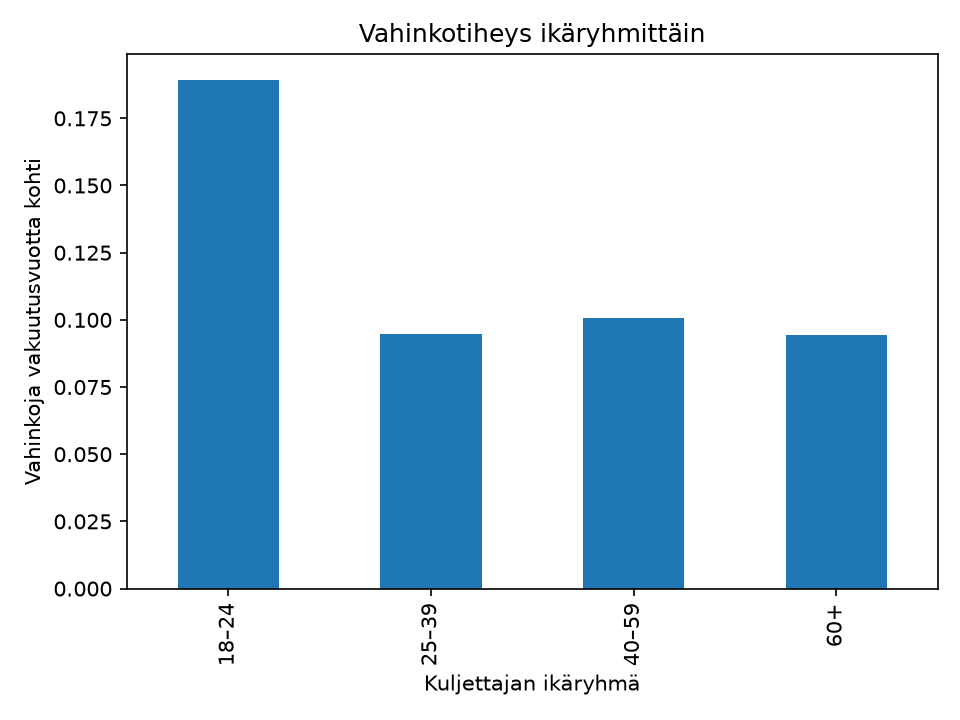
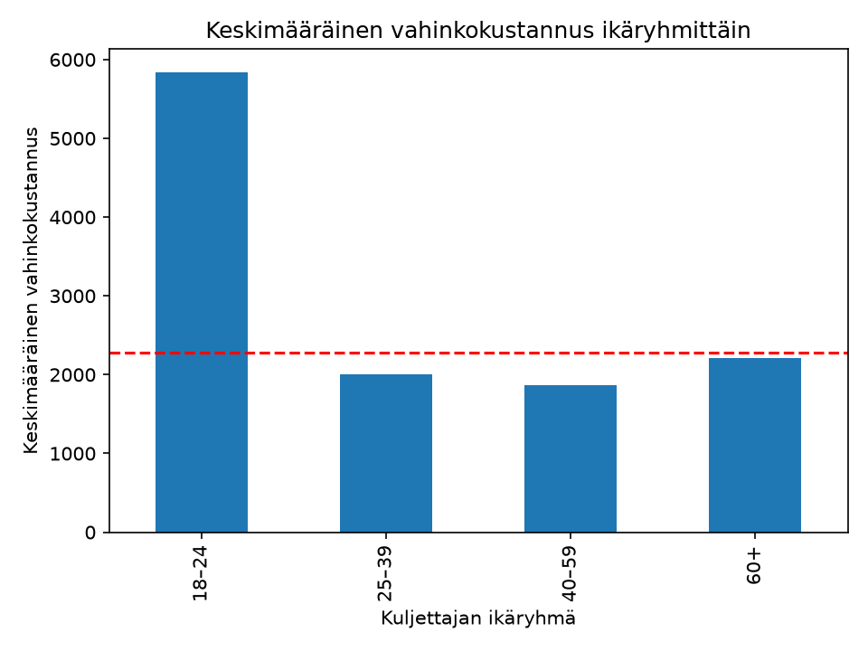

# Insurance-Claims-Data-Analysis

## Projektin kuvaus
Tässä projektissa analysoidaan ranskalaisia liikennevakuutuksia kuvaavaa freMTPL2-aineistoa. Tavoitteena on tutkia vahinkotiheyttä ja vahinkokustannuksia eri ikäryhmissä. Projektissa käytetään SQL:ää ja Pythonia datan analysointiin ja tulosten havainnollistamiseen.

## Lähdeaineisto
Projektissa käytetään freMTPL2freq- ja freMTPL2sev-aineistoja.

Lähdeaineisto: 
https://huggingface.co/datasets/mabilton/fremtpl2

Dutang, C. & Charpentier, A. (2020). Package casdatasets.
casdatasets-paketin dokumentaatio (PDF).

Aineisto: freMTPL2 – Hugging Face.

## Projektin rakenne ja menetelmät

### 1. Datan käsittely - csv_to_sql
 CSV-aineistot tarkistetaan ja siirretään SQL:ään tietokannoiksi. Tämän jälkeen niitä voidaan tarkastella SQL-kyselyillä.

### 2. Vahinkotiheys - claim_frequency
Tässä analyysissa tarkastellaan SQL:ää ja Pythonia käyttäen, kuinka monta vahinkoa sattuu vakuutusvuotta kohden kuljettajien eri ikäryhmissä. Tätä nimetään vahinkotiheytenä. Ikäryhmät ovat 18-24-vuotiaat, 25-39-vuotiaat, 40-59-vuotiaat ja yli 60-vuotiaat.

Analyysi tehdään SQL-kyselyn avulla. SQL:ää käytetään ryhmittelemään aineisto kuljettajien ikäryhmittäin ja laskemaan ikäryhmille vahinkojen määrä ja ikäryhmän vakuutusvuosien kokonaismäärä. Näiden avulla lasketaan vahinkotiheys jakamalla vahinkojen määrä kokonaisvakuutusvuosilla. Lopuksi tulokset esitetään Pythonilla taulukkona ja pylväsdiagrammina.

Analyysin tuloksena saadaan, että 18-24-vuotiaiden ikäryhmässä on selvästi suurin vahinkotiheys, 0,189. Tämä tarkoittaa, että tässä ikäryhmässä vahinkoja tapahtuu 0,189 vakuutusvuotta kohden. Muilla ikäryhmillä vahinkotiheydet ovat 0,101, 0,095 ja 0,094. Tuloksia tulkittaessa on huomioitava rajoitukset, kuten se, että vahinkojen määrään vaikuttaa muitakin tekijöitä, kuin kuljettajan ikä.

### 3. Vahinkokustannukset - claim_severity
Tässä analyysissa tarkastellaan SQL:ää ja Pythonia käyttäen, mikä on keskimääräinen vahinkokustannus kuljettajien eri ikäryhmissä. Ikäryhmät ovat samat kuin claim_frequency-analyysissa.

Analyysi tehdään Pythonia ja SQL:ää käyttäen. Ensin koko datasta lasketaan Pythonia käyttäen vahinkojen määrä, kokonaiskorvaussumma, keskimääräinen vahinkokustannus ja vahinkokustannusten mediaani. Tämän jälkeen SQL:ää  käytetään yhdistämään aineistot IDpol-tunnisteella ja ryhmittelemään aineisto kuljettajien ikäryhmittäin, jonka jälkeen Pythonilla lasketaan jokaiselle ikäryhmälle vahinkojen määrä, kokonaiskorvaussumma ja keskimääräinen vahinkokustannus ja mediaani. Lopuksi tulokset esitetään Pythonilla taulukkona ja pylväsdiagrammina.

Analyysin tuloksena saadaan, että koko aineiston keskimääräinen vahinkokustannus on 2278,536 ja mediaani 1172,0. Ikäryhmien välillä suurin keskimääräinen vahinkokustannus on 18-24-vuotiailla, 5838,56. Kyseisen ikäryhmän mediaani on 1172,0. Siis nuorten keskimääräinen vahinkokustannus on selvästi mediaania suurempi, mikä viittaa siihen, että suuret vahinkokustannukset nostavat keskiarvoa. Muiden ikäryhmien keskimääräiset vahinkokustannukset ovat pienemmät kuin koko aineiston keskiarvo, 2278,536. Tuloksia tulkittaessa on huomioitava rajoitukset, kuten se, että kuljettajan ikä ei ole ainoa vaikuttava tekijä vahingon sattuessa, eikä täten voida varmasti sanoa, että nuoren iän takia korvaussummat olisivat suuremmat.

## Rajoitukset ja jatkokehitys
Tämän projektin tarkoituksena oli toteuttaa rajattu analyysi SQL:ää ja Pythonia käyttäen työnhakua varten. Tulokset kuvaavat tässä aineistossa havaittuja yhteyksiä, eivätkä yksin osoita syy-seuraussuhteita. Projektia voisi jatkaa samoja aineistoja käyttäen esimerkiksi tutkimalla vahinkotiheyttä alueen tai ajoneuvon iän perusteella.
